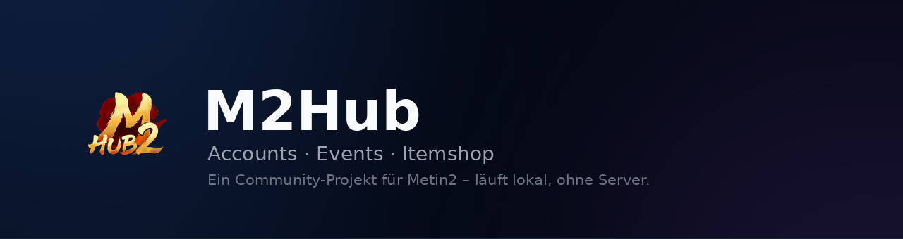

<div align="center">



<br>

[](https://github.com/EinfachFabsTV/Metin2Hub/releases/latest)
[](https://github.com/EinfachFabsTV/Metin2Hub/releases)
[](https://github.com/EinfachFabsTV/Metin2Hub/releases/latest)
[](LICENSE)

### [⬇️ &nbsp; Download M2Hub](https://github.com/EinfachFabsTV/Metin2Hub/releases/latest)

**Free · no installation · no account · no ads**

<br>

<sub>[Deutsch](README.md) · **English** · [Türkçe](README.tr.md) · [Italiano](README.it.md)</sub>

</div>

---

M2Hub is a program for your own computer. It gathers what otherwise lives in
forum tabs, sticky notes and spreadsheets: which events are running, what is
coming up in the item shop, how your accounts and characters are doing, what
the evening's runs brought in – and what a guild level costs.

> The interface is available in **German, English, Turkish and Italian**. The
> data always comes from the official German forum; it is translated when it is
> displayed.

## What M2Hub does

<table>
<tr>
<td width="33%" valign="top">

### 👤 &nbsp;Accounts

Every account at a glance, with characters, levels and donated medals.

Who has already done the **orc tooth biologist** is as visible as the **Meley
characters** and the ones still **levelling**. Medals are added with one click,
for many characters at once if you like.

If you play clients in several **languages**, assign each account its language
and tell them apart by colour.

</td>
<td width="33%" valign="top">

### 📅 &nbsp;Events

The **event calendar per server** – Ruby/Sapphire and Tigerghost each as their
own tab, with an icon for every entry.

Plus the **worldwide announcements** with image, period and text.

What is running right now stands **at the top of the window** – even while you
are looking at your accounts.

</td>
<td width="33%" valign="top">

### 🛒 &nbsp;Item shop

The **running and upcoming offers**, sorted by time.

**Happy hours** appear at the top of the window while they last.

Expired entries can be shown with a checkbox, for when you want to look up what
was on offer recently.

</td>
</tr>
<tr>
<td width="33%" valign="top">

### 🐉 &nbsp;Runs

The **run tracker**: Hydra, Razador, Nemere, Jotun, Beran and the snake run,
each with its loot.

Enter chests and the app works out **day, month and all time** – including the
yield in won. Days that already carry entries are **green** in the calendar.

Plus a **cooldown** per run that counts down at the press of a button – and the
timer window over the game for several setups.

</td>
<td width="33%" valign="top">

### 🧮 &nbsp;Calculator

The **guild calculator**: how many donations are missing from level to level,
how long that takes and what it costs.

Small, medium and high donations can be switched on and off separately.

</td>
<td width="33%" valign="top">

### 🏠 &nbsp;Home

An **overview made of sections you choose yourself**: what is running, the
day's runs, the calendar, open biologists, medals due.

Two arrangements – **overview** for looking things up, **workbench** for
entering them – with a switch between the two.

</td>
</tr>
<tr>
<td width="33%" valign="top">

### 🎯 &nbsp;Goals

A **goal in won** – “1500w for X” – with further goals queued behind it.

The **profit counts itself**: whatever the runs you entered have brought in
since the goal started. By hand you only add **expenses** (push, costumes,
anything else), extra income and **what is still sitting in your shop**.

Next to it the **debt calculator**: how many runs are missing until it is paid
off.

</td>
<td width="33%" valign="top">

### ⏱️ &nbsp;Timers over the game

A small window above Metin2, **one button per setup**: two Hydra characters,
two clocks. A click starts it, the next one stops it, and at the end **a sound
plays** (four to choose from).

If you like, the **chest buttons** sit underneath: 0–5 for Hydra, 8–10 for
Razador. One click logs the run – no keyboard needed.

</td>
<td width="33%" valign="top">

### 📺 &nbsp;For streaming

Debts, chests, runs, the active goal and the cooldowns **as an overlay for
OBS** – ready-made cards in the look of the app, plus every number on its own
as a text file.

**No server and no port**: M2Hub writes the files into your own profile, OBS
reads them from disk. Opacity and size are set inside the app.

</td>
</tr>
</table>

After every update M2Hub shows you once **what has changed**.

## Getting started

1. On the [download page](https://github.com/EinfachFabsTV/Metin2Hub/releases/latest)
   download the file `M2Hub.exe`.
2. Double-click – done. There is no installation and no setup.
3. On the first start Windows shows a blue warning. That is normal and
   explained step by step below: [The blue Windows warning on first
   start](#the-blue-windows-warning-on-first-start).

Windows 10 or newer is required. Nothing else needs to be installed – the
program brings everything it needs.

## The blue Windows warning on first start

The first time you open it, a blue window appears:

> **Windows protected your PC**
> Microsoft Defender SmartScreen prevented an unrecognised app from starting.

At first there is only a **“Don't run”** button. The way to start it leads
through the link:

| Step | What to do |
|:--:|---|
| 1 | Click **“More info”** – the link below the text |
| 2 | The window expands and shows `App: M2Hub.exe` and `Publisher: Unknown publisher` |
| 3 | Click **“Run anyway”** |

That is it – the warning only appears the first time. After that M2Hub starts
with a double-click.

> [!TIP]
> **If “More info” is missing** or the download was blocked beforehand:
> right-click `M2Hub.exe` → **Properties** → under “Security” tick
> **“Unblock”** → **OK**.

### Why does this warning appear?

It says nothing about the contents of the file. Windows simply does not know
the program yet: SmartScreen warns about every application that neither carries
a purchased signature nor has already been downloaded by many people. Such a
signature costs several hundred euros a year – for a free community project
that is not reasonable.

So it is **not a virus warning**, but a note about an unknown publisher. As the
number of downloads grows it disappears by itself.

### Staying safe

- **Only download M2Hub from the
  [official download page](https://github.com/EinfachFabsTV/Metin2Hub/releases/latest).**
  Files from forums, file hosters or Discord attachments may have been altered –
  there the warning is justified.
- The file is always called `M2Hub.exe` and is around 92 MB. Noticeably smaller
  files or variants with additions in the name do not come from here.
- To be completely sure, compare the checksum: next to the file on the release
  page there is a `sha256:…` value. In PowerShell `Get-FileHash .\M2Hub.exe`
  returns the same value if the file is unchanged.

Should your virus scanner raise an alarm, that too is down to the unknown
publisher – it is a false positive. If you are unsure, upload the file to
[VirusTotal](https://www.virustotal.com) and look at the result before starting
it.

## 🔒 &nbsp;Your data stays on your computer

That is not a promise but a design decision: **M2Hub has no server.** There is
no place the data could flow to.

|  | |
|:--:|---|
| 🚫 | **No account, no login, no password.** There is nothing to create and nothing to lose. |
| 💾 | **Accounts, characters, medals and the runs you entered live with you only**, in files in your Windows user folder. They are not transferred anywhere – not to us either. |
| 👁️ | **No collection of usage data**, no ads, no tracking pixels. |
| 🔑 | **You are never asked for credentials.** M2Hub does not need your game password and would not store it. If a program claiming to be M2Hub ever asks for it, it is not M2Hub. |

The program reaches into the network in one place only: it reads the public
event calendar and the announcements in the official Metin2 forum – the same
pages you would open in a browser. Those entries are cached on your own
computer; what is running or still to come stays, expired entries are discarded
after seven days. No personal data is transmitted.

To back up your entries or take them to another computer, copy the files
`accounts.json`, `runs.json` and `goals.json` – found via **Settings → Open
folder**. The runs you entered are never discarded; they are your own
measurements, not fetched data.

## Updates

On start M2Hub checks whether a newer version is available. At the press of a
button the app downloads it, replaces itself and restarts – no manual download
needed.

If you would rather it did not, switch the check off in the settings.

## Source code

The complete source code of the app lives in this repository under
[`desktop/`](desktop). It is updated with every release by the same workbench
that builds `M2Hub.exe` – program and source always belong to the same state.

So anyone who wants to know what the program does need not take anybody's word:

- **No account, no server.** There is no login and no service receiving data.
  See [`Services/LocalStore.cs`](desktop/M2Hub.Desktop/Services/LocalStore.cs):
  everything is JSON in your own profile.
- **A single destination on the network** – the official German forum. The
  three addresses are written out in
  [`Services/Forum/ForumSource.cs`](desktop/M2Hub.Desktop/Services/Forum/ForumSource.cs);
  the only other connection goes to GitHub, to look for a newer version.
- **No WebView, no Chromium.** Drawing goes through Avalonia/Skia; there is no
  browser engine in which foreign code could run.

### Building it yourself

With the [.NET SDK 9](https://dotnet.microsoft.com/download) and nothing else:

```bash
cd desktop/M2Hub.Desktop
dotnet publish -c Release -r win-x64 --self-contained true \
  -p:PublishSingleFile=true -p:IncludeNativeLibrariesForSelfExtract=true
```

### Checking the downloaded file

For every release the SHA256 checksum of `M2Hub.exe` stands in the release
notes. To recompute it on Windows:

```powershell
Get-FileHash .\M2Hub.exe -Algorithm SHA256
```

If the value matches, the file is unchanged the one built from the source code
visible here.

### Why SmartScreen complains

The file is not signed with a certificate – such certificates cost money and
say nothing about the contents. Windows therefore does not know the file and
warns. Source code and checksum say more than a signature.

## Feedback

Bugs, wishes and remarks belong in the
[issues](https://github.com/EinfachFabsTV/Metin2Hub/issues). Screenshots help a
lot, as does the version you are using – it stands in the settings.

## ⚠️ &nbsp;Notice

> **M2Hub is a community project and has no connection to Gameforge or to
> Metin2.** It is not an official offering, it is neither run nor supported nor
> reviewed by Gameforge, and it does not speak for the company.

The program only reads publicly visible forum posts and displays them more
clearly. It does not interfere with the game, changes nothing in the client and
automates no in-game actions.

All brand and product names belong to their respective owners. “Metin2” is a
trademark of Gameforge 4D GmbH.

No guarantee is given for information taken from the forum – in case of doubt
the official announcement always applies.

## License

[GNU General Public License v3.0](LICENSE)

<div align="center">
<br>
<sub>Made for the Metin2 community.</sub>
</div>
